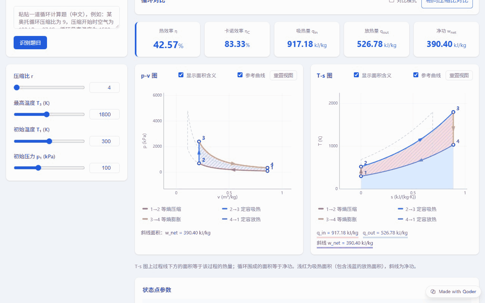
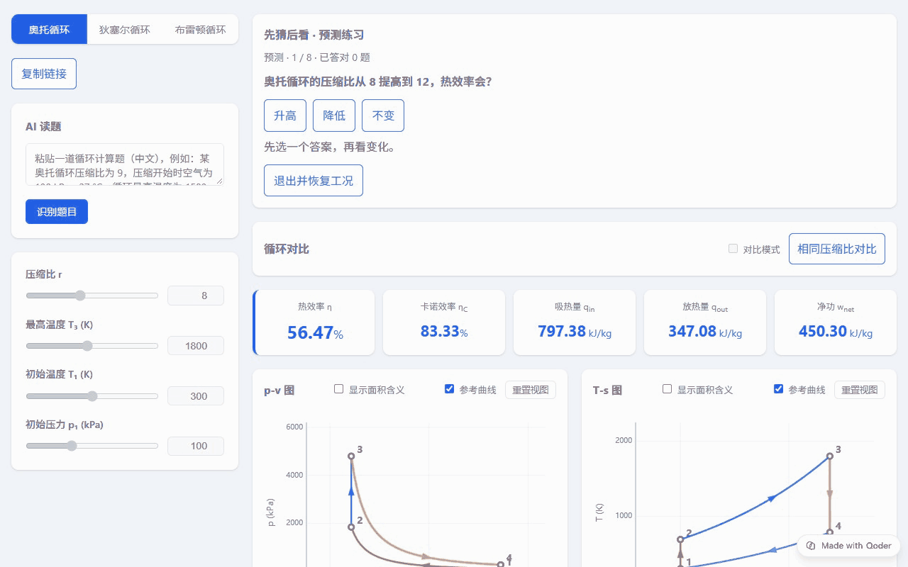
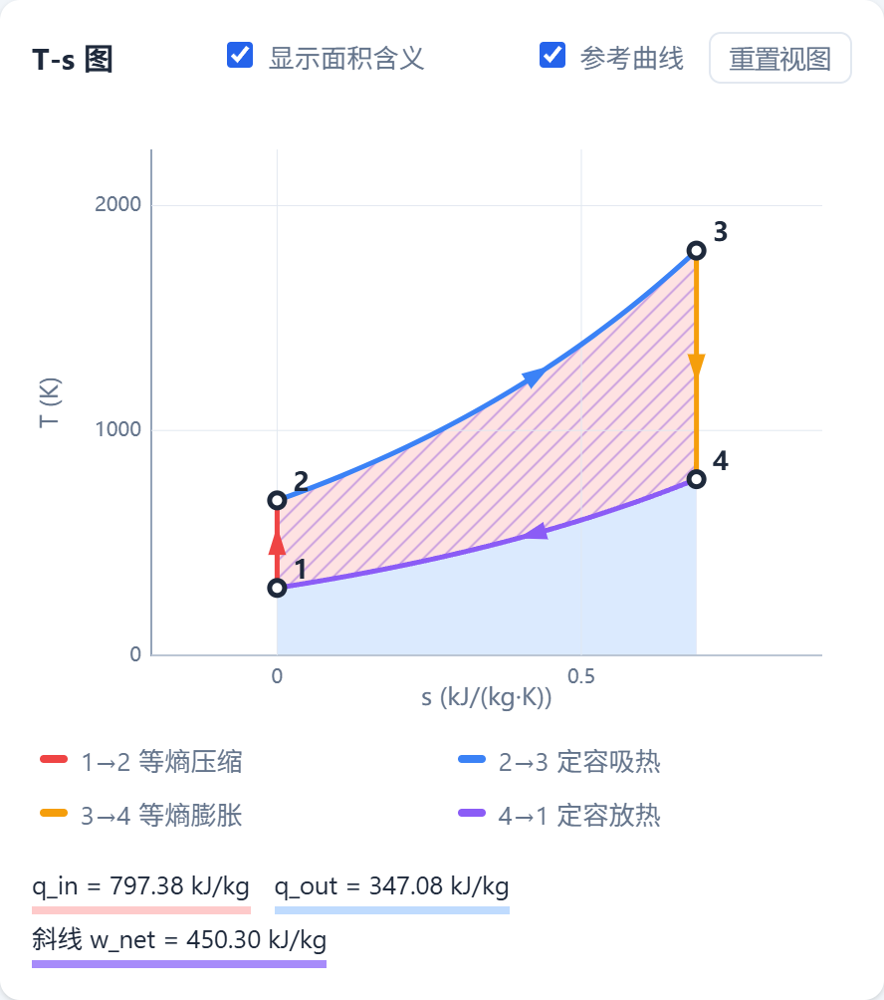
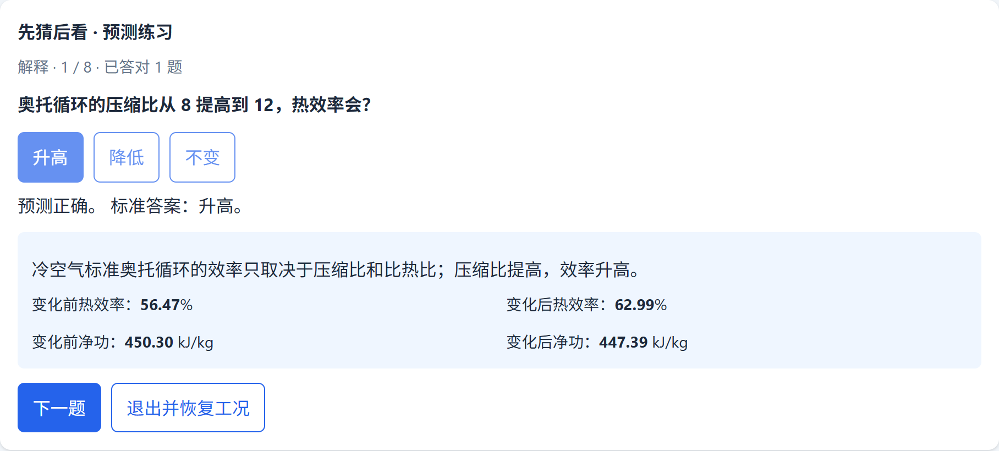

# CycleLab · 工程热力学循环交互学习器

> 拖动参数，实时看到 p-v 图、T-s 图和热效率怎么变；每一步推导都代入真实数字。

**在线体验**：<https://cyclelab-98jh7w97aep.qoder.zone/>



## 为什么做这个

学《工程热力学》的奥托、狄塞尔、布雷顿循环时，书上只给一组算好的数字，很难直观看到"压缩比变大，图像怎么变、效率为什么升高"。CycleLab 把公式和图对应起来，适合能源动力、机械、车辆类本科生复习，也可以用于课堂演示。

## 功能

- **三种循环**：奥托 / 狄塞尔 / 布雷顿（布雷顿支持回热）
- **实时计算**：滑块调参数，状态点、q_in、q_out、w_net、热效率和卡诺效率同步刷新
- **p-v 图与 T-s 图**：可显示"面积含义"（吸热、放热、净功），并给出积分数值
- **推导过程**：每个过程的公式与代入数字逐步列出
- **先猜后看**：先预测参数变化对效率的影响，再观察图像验证
- **循环对比**：多个循环叠加在同一张图上，附结果对比表
- **分享工况**：参数编码在链接里，复制给同学即可打开同一工况
- **AI 读题**：粘贴一道循环计算题，自动识别循环类型和参数并填入页面
- **问问 AI 助教**：结合当前页面的计算结果，回答"为什么"类问题



| 面积含义 | 先猜后看 |
|---|---|
|  |  |

## 设计原则：数值交给代码，解释交给 AI

AI 容易"一本正经地算错数"，所以 CycleLab 里所有数值都由前端代码按公式计算：

- **AI 读题**只负责把题目转成"循环类型 + 参数"的 JSON；前端再做范围校验，超出范围会截断并提示，缺失参数使用默认值并说明。
- **AI 助教**提问时会附带当前循环、参数和全部状态点，回答基于页面真实结果；后端还会过滤掉模型自行生成的数字，只保留定性解释。
- AI 不可用时（未配置 key、超出每日额度）只隐藏或提示 AI 功能，其他功能照常使用。

## 物理模型

空气标准循环，冷空气假设：κ = 1.4，cp = 1.005 kJ/(kg·K)，cv = cp/κ，R = cp − cv；所有过程按可逆过程处理。状态 1 的比熵取 0 作为基准。

## 项目结构

```
├── index.html          页面结构
├── style.css           样式（响应式，手机和电脑都能用）
├── config.js           AI 功能开关 AI_ENABLED
├── thermo.js           核心：循环计算、Canvas 绘图、推导、分享链接、AI 调用
├── quiz.js             "先猜后看"预测练习
├── compare.js          循环对比模式
├── tour.js             首次打开的使用引导
├── functions/index.ts  后端函数（Deno）：/ai/parse-question 与 /ai/ask，调用通义千问 qwen-flash
├── spec*.md            需求与设计文档
└── test-*.py / test-ai.js  测试脚本
```

前端为纯 HTML + CSS + 原生 JavaScript，图表用 Canvas 自绘，不依赖任何框架。

## 本地运行

```bash
python -m http.server 8000
# 浏览器打开 http://localhost:8000
```

本地只运行静态页面时 AI 功能不可用（需要后端函数），其余功能完整可用。

### 启用 AI 功能

将 `functions/index.ts` 部署为后端函数（本项目部署在 Qoder Sites），并参考 [.env.example](.env.example) 配置环境变量，至少需要 `DASHSCOPE_API_KEY`。

## 测试

- 浏览器控制台运行 `runTests()`：核心计算验收测试
- `python test-*.py`：界面与功能回归测试（需要 `pip install playwright` 并安装浏览器）
- `node test-ai.js`：后端函数测试

## 开发说明

本项目借助 AI 编程工具 Qoder 开发：需求和设计写在 `spec*.md` 中，由 Qoder 按 Spec 逐项实现与测试。

## License

[MIT](LICENSE)
